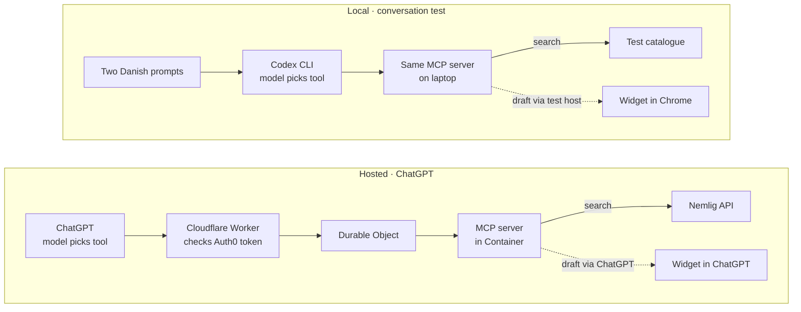
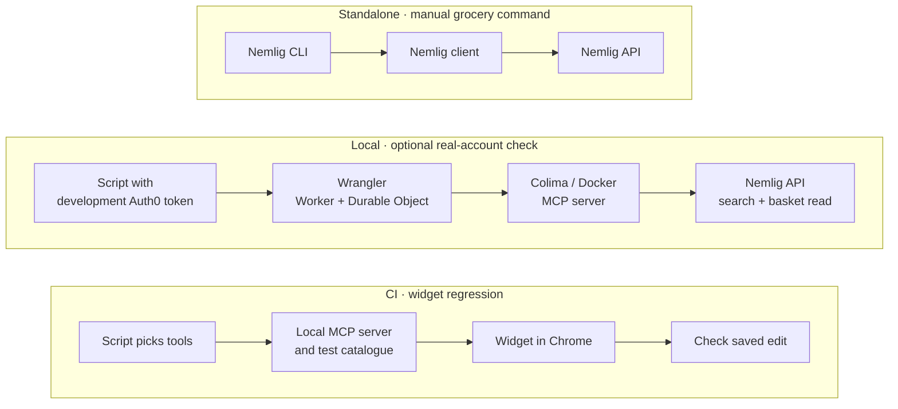

# Test a Nemlig conversation locally

## Hosted and local paths

Read each row **left to right**. Follow the arrows from the tool caller to the data it uses. The dotted arrows show where the review appears.



In the hosted path, Auth0 issues the access token. The Worker checks it before the Durable Object admits the request to the Container. A product search uses the user's Nemlig connection. Reopening a temporary draft reads the server's draft state. In the local conversation test, Codex calls MCP directly. Clicking **+** in Chrome sends the edit back to that same server.

### Other ways to exercise the app



The standalone Nemlig CLI goes directly to the provider. **Codex CLI** supplies the model conversation in the local test. **Wrangler CLI** runs the local Cloudflare stack for the optional real-account check.

## Run the deterministic check

From a bootstrapped checkout with Google Chrome installed, run the deterministic browser check first.

```sh
pnpm --filter nemlig-assistant eval:conversation:widget
```

This builds the current widget, starts an ephemeral synthetic MCP server, creates a one-item oat drink draft and displays the actual show-tool response in Chrome. The check opens the product actions, increases the quantity and reads back the same draft through MCP. The fixture must exit cleanly with zero forbidden provider calls. CI runs this check with the built assets.

## Exercise model routing

With an existing ChatGPT sign-in in the native Codex CLI, run:

```sh
pnpm --filter nemlig-assistant eval:conversation
```

The driver sends “Lav en kladde med havredrik” and “Vis mig listen” in a single ephemeral thread. It checks the returned draft and review identifiers, then hands the model-selected result to the browser check. A successful run uses two model turns under the signed-in account. The driver selects the account’s advertised default. Set `NEMLIG_EVAL_MODEL` to compare runs with a specific available model. An unexpected tool choice or an isolation failure fails the run. A green deterministic check alone covers only the scripted handoff.

## Interpreting failures

| Failure | Inspect |
| --- | --- |
| Native preflight | CLI version and sign-in, available MCP tools, effective sandbox and its read/write/network canaries |
| Model chooses the wrong tool or draft | Tool descriptions, returned handles and the preceding turn |
| Product fails to render or the edit disappears | Tool metadata, the built UI resource, host messages and exact-draft readback |
| Live provider read fails | Local Worker admission, owner connection and provider response, using the separate [local provider check](local-provider-check.md) |

Use the [routing evaluation](nemlig-routing-evaluation.md) for broader model trials and the [ChatGPT smoke runbook](nemlig-chatgpt-smoke-test.md) for installed connector, OAuth callback and host rendering changes. Native model choices and the simulated host approximate those user journeys. Production ingress and ChatGPT-specific behavior require evidence from their respective environments.
